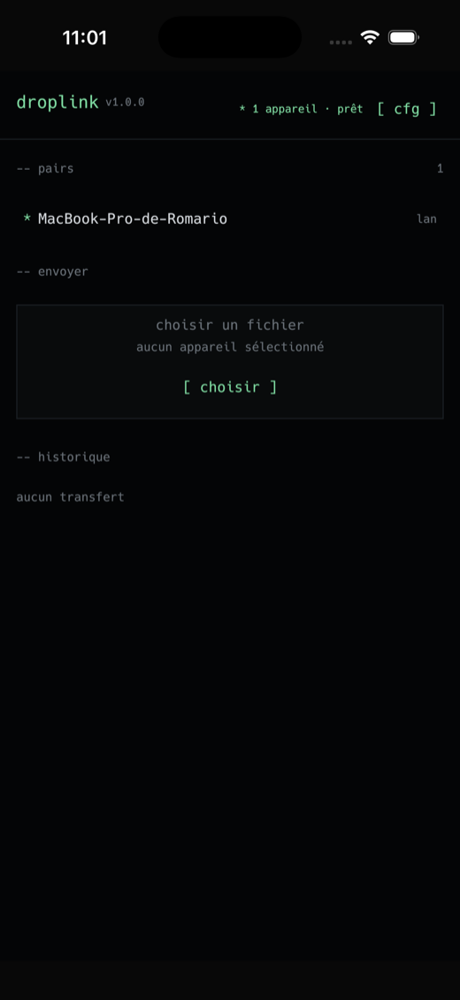

# DropLink

**Transfert de fichiers P2P, chiffré de bout en bout. Rust natif, sans compte, sans serveur, sans télémétrie.**

[](docs/CHANGELOG.md)
[](rust-toolchain.toml)
[](#ios)
[](LICENSE)

<p align="center">
  
</p>

---

## Pourquoi DropLink

AirDrop fonctionne très bien entre appareils Apple. DropLink fait la même chose **partout** : macOS, Windows,
Linux et iOS, sans compte, sans cloud, sans serveur obligatoire. Deux appareils sur le même réseau se voient,
un fichier part, il arrive vérifié et chiffré.

- **100 % Rust** : cœur, réseau, chiffrement et UI native (egui/eframe). Aucun Node, aucune WebView.
- **Chiffrement de bout en bout** : X25519 + HKDF-SHA256 + ChaCha20-Poly1305, une clé par direction.
- **Code de sécurité à 6 chiffres** (SAS) affiché des deux côtés avant d'accepter : détection d'homme du milieu.
- **Découverte locale** : mDNS/DNS-SD sur desktop, **Bonjour** sur iOS (autorisé sans entitlement Apple).
- **Intégrité prouvée** : BLAKE3 calculé pendant l'envoi, vérifié avant publication du fichier.
- **Relay optionnel** : circuits WebSocket chiffrés pour deux réseaux différents ; le serveur ne voit que du
  ciphertext. Désactivé par défaut.

---

## Fonctionnalités

| Domaine | Détail |
|---|---|
| Découverte | mDNS sur le LAN, Bonjour sur iOS, identité par `device_id` UUID (jamais le nom ni l'IP) |
| Transfert | TCP direct, chunks de 256 Kio, BLAKE3 en streaming, ACK final signé |
| Chiffrement | X25519 éphémère, HKDF-SHA256, ChaCha20-Poly1305, compteur de nonce par direction |
| Fichiers | nom assaini (traversée, noms réservés Windows, longueur), écriture `.part`, publication atomique |
| Multi-fichiers | une ligne de progression par transfert, vitesse, annulation |
| iOS | sélecteur natif Photos/Fichiers, dossier de réception choisi dans Fichiers, export auto vers Photos |
| Historique | succès uniquement, ouverture du fichier d'un clic (Finder / feuille de partage iOS) |
| Erreurs | toast court, transferts échoués retirés des listes |
| Relay | circuits opaques, caps durs, heartbeat, reconnexion avec backoff |
| Qualité | 157 tests, clippy `-D warnings`, `cargo deny`, couverture 87 %, fuzz 181 M exécutions |

---

## Démarrage rapide

### Desktop (macOS, Windows, Linux)

```bash
cargo run -p droplink-app
```

Deux appareils sur le même Wi-Fi s'affichent dans `-- pairs`. Sélectionne un pair, dépose un fichier (ou
`[ choisir ]`), accepte de l'autre côté et compare le code SAS.

### iOS

Voir [`docs/IOS.md`](docs/IOS.md) pour le détail. Résumé :

```bash
rustup target add aarch64-apple-ios aarch64-apple-ios-sim
brew install xcodegen

cd ios && xcodegen generate
xcodebuild -project DropLink.xcodeproj -scheme DropLink \
  -sdk iphoneos -destination 'generic/platform=iOS' \
  -configuration Debug -allowProvisioningUpdates \
  -derivedDataPath build-device build

xcrun devicectl device install app --device <UDID> \
  build-device/Build/Products/Debug-iphoneos/DropLink.app
xcrun devicectl device process launch --device <UDID> com.droplink.desktop
```

La signature automatique utilise `DEVELOPMENT_TEAM` dans `ios/project.yml`. Au premier lancement, approuve le
profil : **Réglages → Général → VPN et gestion de l'appareil → Apple Development → Faire confiance**.

Sur iPhone :

- les **images et vidéos** reçues sont enregistrées dans **Photos** ;
- le reste est copié dans le **dossier choisi** dans Fichiers (`cfg → Destination → [ choisir ]`) ;
- la copie de travail reste dans `Fichiers → Sur mon iPhone → DropLink`, et un clic sur la ligne de l'historique la présente.

---

## Comment ça marche

```
expéditeur                                          récepteur
   │ Hello { version, transfer_id, clé éphémère A,  │
   │         nom, taille, chunk_size, alias }        │
   ├────────────────────────────────────────────────▶│
   │◀────────────────────────────────────────────────┤ KeyOffer { clé éphémère B }
   │                                                 │
   │  shared     = X25519(A, B)                      │
   │  transcript = BLAKE3("droplink/v2" || hello || B)
   │  key_s2r / key_r2s = HKDF(shared, transcript)   │
   │  SAS       = 6 chiffres du transcript           │
   │                                                 │
   │◀────────────────────────────────────────────────┤ Accept (scellé)
   │ Data scellées (ChaCha20-Poly1305)               │
   ├────────────────────────────────────────────────▶│
   │ End { BLAKE3 du fichier } (scellé)              │
   ├────────────────────────────────────────────────▶│
   │◀────────────────────────────────────────────────┤ Done { ok } (scellé)
```

- Chaque direction possède **sa clé** et **son compteur de nonce**.
- Toutes les frames après `KeyOffer` sont scellées, y compris `Done` : un « terminé » ne peut pas être forgé.
- Le récepteur écrit dans `<nom>.part`, vérifie taille + BLAKE3, puis publie par `hard_link` atomique.
- Le protocole est décrit en détail dans [`docs/ARCHITECTURE.md`](docs/ARCHITECTURE.md).

---

## Sécurité

| Protégé | Non protégé |
|---|---|
| Confidentialité et intégrité du contenu (LAN et relay) | Un utilisateur qui ne compare pas le SAS |
| Métadonnées du fichier (nom, taille, alias) via le transcript | La disponibilité (un attaquant peut couper un transfert) |
| Identité locale (`device_id` persistant) | Le nom et l'IP visibles en mDNS sur le LAN |

Le relay ne reçoit que des identifiants de circuit et du ciphertext. La vérification « aucune fuite en clair »
est un test d'intégration (`relay_no_plaintext_leak`). Détails : [`docs/SECURITY.md`](docs/SECURITY.md) et
[`docs/THREAT-MODEL.md`](docs/THREAT-MODEL.md).

---

## Architecture

```
crates/
├── droplink-core/        protocole, frames, pairs, hash, chemins, registre, config, crypto
├── droplink-net/         moteur de transfert, framing async, mDNS, transports direct/relay
├── droplink-app/         UI egui + shell desktop/iOS
├── droplink-ios/         shim FFI (staticlib) pour Xcode
├── droplink-ios-bridge/  pont Rust ↔ Swift (Bonjour, picker, export Photos/Fichiers)
├── droplink-relay/       serveur axum de circuits opaques
└── xtask/                perf, bundle, lint
ios/                      projet Xcode généré par xcodegen
fuzz/                     cibles cargo-fuzz
```

`droplink-core` est **pur** : ni I/O, ni async, ni runtime. Tout y est testable en millisecondes.

---

## Développement

```bash
cargo test --workspace                     # 157 tests
cargo clippy --workspace --all-targets -- -D warnings
cargo fmt --all -- --check
cargo run -p droplink-app                  # desktop
cargo run -p droplink-app -- --smoke       # démarrage sans fenêtre + mesure
cargo xtask perf                           # taille binaire, startup, benchs
```

Tests réseau réellement exécutés (sockets, pas de mock) :

```bash
cargo test -p droplink-net --test direct_transfer
cargo test -p droplink-net --test relay_transfer
cargo test -p droplink-net --test mdns_loopback -- --ignored --nocapture
```

### Couverture

```bash
cargo llvm-cov --workspace --fail-under-lines 85 \
  --ignore-filename-regex 'main\.rs$|app\.rs$|xtask/'
```

Mesure actuelle : **87,45 %** des lignes hors points d'entrée binaires et xtask.

### Fuzzing

```bash
# avec le shim rustup (Homebrew cargo ne gère pas +nightly)
export PATH="$HOME/.cargo/bin:$PATH"
rustup run nightly cargo fuzz run fuzz_frame   -- -max_total_time=600
rustup run nightly cargo fuzz run fuzz_control -- -max_total_time=600
rustup run nightly cargo fuzz run fuzz_txt     -- -max_total_time=600
```

Dernière campagne : **181,5 M exécutions**, aucun crash.

### Packaging

```bash
cargo xtask bundle        # macOS .app/.dmg (cargo-bundle)
cargo xtask bundle-msi    # Windows .msi (cargo-wix)
```

---

## Performances mesurées

| Métrique | Valeur | Budget |
|---|---|---|
| BLAKE3 vs SHA-256 | **4,11×** plus rapide | ≥ 3× |
| Transfert loopback (256 Mio) | **425–436 MB/s** | ≥ 250 MB/s |
| Démarrage interne | **1 ms** | < 250 ms |
| Binaire release (strippé, LTO) | **6,36 Mo** | < 20 Mo |
| Couverture lignes | **87,45 %** | ≥ 85 % |
| Fuzz | **181,5 M exécutions, 0 crash** | 10 min/cible |

Détails et commandes : [`docs/PERF.md`](docs/PERF.md).

---

## Envoi à distance (relais)

Deux appareils sur deux réseaux, sans compte :

1. `pairs → connexion → créer un code` : le serveur émet un code 8 caractères (`ABCD-2345`),
   valable 5 minutes, renouvelable.
2. L'autre appareil saisit le code (`rejoindre`).
3. Le fichier part par le relais ; le destinataire compare le SAS à 6 chiffres avant d'accepter.

Le relais ne déchiffre rien : il relaie des trames `[circuit_id 16 octets || ciphertext]`. Il ne
voit ni nom de fichier ni contenu. Le direct reste prioritaire quand les deux appareils sont sur
le même réseau.

Déploiement : voir `deploy/README.md` (systemd + Caddy WSS). Détails : `docs/REMOTE.md`.

---

## Dépannage

| Symptôme | Cause probable | Solution |
|---|---|---|
| Aucun pair détecté | Réseaux différents (ex. Mac sur le partage de connexion de l'iPhone, iPhone sur un Wi-Fi) | Mettre les deux appareils sur le **même routeur Wi-Fi** |
| Aucun pair détecté sur un LAN | mDNS bloqué (isolation client, réseau d'entreprise) | Vérifier le réseau, ou activer le relay |
| Un « iPhone » fantôme | une instance (souvent le simulateur) annonce le service | fermer l'instance ; le navigateur ignore désormais son propre `device_id` |
| Transfert refusé | popup non acceptée ou délai de 60 s dépassé | accepter dans la fenêtre, comparer le SAS |
| `Operation not permitted` sur iOS | ancien chemin de sandbox persisté | corrigé : le dossier est recalculé à chaque démarrage |
| Fichier introuvable dans l'historique | fichier déplacé/supprimé depuis | l'historique ne garde que les fichiers présents |
| Un clic sur une ligne ne l'ouvre pas | fichier absent du sandbox | un toast `! fichier introuvable` s'affiche |

---

## Limites

- Pas de reprise d'un transfert interrompu ni de chiffrement au repos.
- Android non pris en charge.
- Distribution iOS : équipe personnelle (expiration 7 jours) ou compte développeur pour un profil durable.
- Le SAS doit être comparé par un humain ; sans cela, un homme du milieu reste possible.
- Le relay par défaut (room dérivée de l'IP publique) doit être déployé par tes soins.

---

## Licence

MIT — voir [`LICENSE`](LICENSE).
